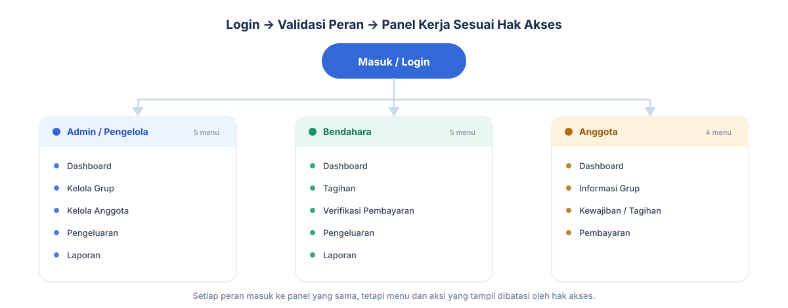
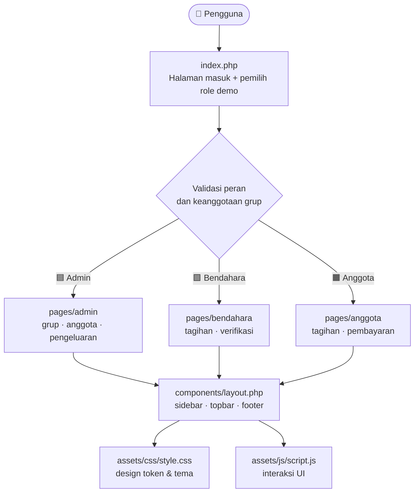
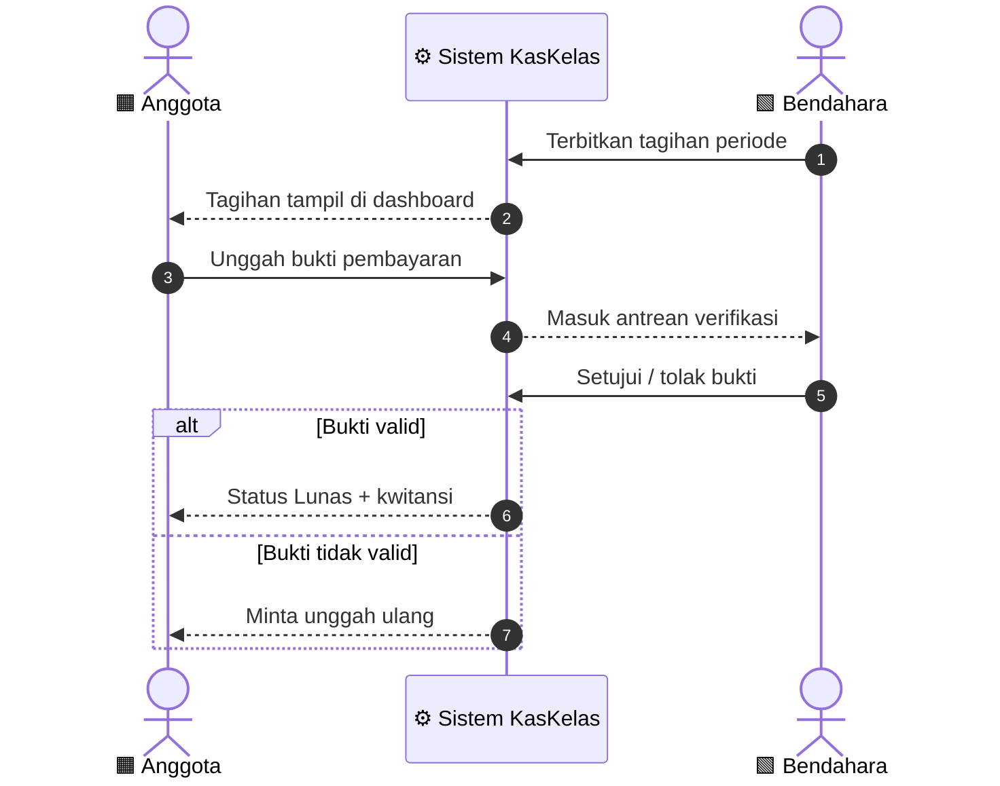

<div align="center">
  
</div>

<div align="center">


</div>

<div align="center">

**KasKelas** adalah sistem informasi manajemen kas kelas berbasis web: mencatat iuran, menerbitkan tagihan,
memverifikasi pembayaran, mencatat pengeluaran, dan menyajikan laporan keuangan — dengan **tiga peran** yang
saling terhubung: **Admin**, **Bendahara**, dan **Anggota**.

</div>

---

## 📑 Daftar Isi

| | | |
|:--|:--|:--|
| [📖 Tentang Proyek](#-tentang-proyek) | [🧭 Alur Sistem](#-alur-sistem) | [🧩 Arsitektur Proyek](#-arsitektur-proyek) |
| [👤 Peran Pengguna](#-peran-pengguna) | [✨ Fitur Utama](#-fitur-utama) | [💸 Alur Pembayaran](#-alur-pembayaran) |
| [🗂️ Struktur Proyek](#-struktur-proyek) | [🛠️ Teknologi](#-teknologi) | [🚀 Cara Menjalankan](#-cara-menjalankan) |
| [🗺️ Roadmap](#-roadmap) | [👥 Tim Pengembang](#-tim-pengembang) | [🤝 Kontribusi](#-kontribusi) |

---

## 📖 Tentang Proyek

> **Proyek Berbasis Web** yang dikembangkan sebagai bagian dari luaran mata kuliah *Project Based Learning* (PBL).
> Aplikasi ini dirancang untuk memecahkan permasalahan nyata melalui solusi digital berbasis web yang interaktif,
> responsif, dan mudah digunakan.

Pengelolaan kas kelas secara manual rawan hilang, tidak konsisten, dan sulit diaudit. **KasKelas** merangkum seluruh
siklus uang kelas dalam satu tempat: dari anggota membayar iuran, bendahara memverifikasi, hingga admin menutup
periode dengan laporan.

<details>
<summary><b>🎯 Latar belakang & tujuan</b> (klik untuk membuka)</summary>

- **Masalah** — pencatatan iuran kelas masih manual (buku/chat), membuat rekapitulasi lambat dan status pembayaran tidak transparan.
- **Tujuan** — menyediakan satu sumber kebenaran untuk pemasukan, pengeluaran, dan status kewajiban tiap anggota.
- **Manfaat** — bendahara hemat waktu, anggota dapat melihat status & bukti bayar, admin memperoleh laporan yang siap diaudit.

</details>

> [!NOTE]
> Repositori ini saat ini berisi **prototype frontend**. Autentikasi, basis data, dan logika backend sedang dalam
> pengembangan (lihat [Roadmap](#-roadmap)).

---

## 🧭 Alur Sistem

Alur utama aplikasi: pengguna masuk, sistem memvalidasi kredensial dan keanggotaan grup, lalu mengarahkan ke panel
yang sesuai dengan hak akses perannya.

<picture>
  <source media="(prefers-color-scheme: dark)" srcset="assets/readme/flow-dark.svg">
  
</picture>

<details>
<summary><b>🔁 Rincian langkah alur</b></summary>

1. **Masuk** — pengguna mengisi email/username dan password pada `index.php`.
2. **Validasi** — kredensial diverifikasi, kemudian dipetakan ke **role** dan **membership grup**.
3. **Pengalihan** — sistem membuka panel sesuai peran (`pages/admin`, `pages/bendahara`, `pages/anggota`).
4. **Operasi** — setiap peran menjalankan aksinya pada menu yang tersedia (dibatasi hak akses).
5. **Keluar** — sesi dihentikan dan pengguna kembali ke halaman login.

</details>

> [!TIP]
> Ingin melihat ketiga alur tanpa akun? Halaman login menyediakan tombol **Demo Role** untuk melompat langsung
> ke panel Admin, Bendahara, atau Anggota.

---

## 🧩 Arsitektur Proyek

Bagaimana berkas-berkas di repositori ini saling terhubung — **klik simpul bertanda tautan** pada diagram untuk
membuka berkas/foldernya.



**Prinsip yang dipegang:**

- **Satu layout, banyak peran** — `components/layout.php` menjadi kerangka bersama; halaman peran hanya mengisi konten.
- **Tema terpusat** — warna, radius, dan bayangan hidup sebagai variabel CSS (`--navy`, `--blue`, `--green`, `--orange`).
- **Interaksi ringan** — JavaScript vanilla menangani menu responsif, toggle password, dan pemilih role demo.

---

## 👤 Peran Pengguna

Satu panel, tiga sudut pandang. Menu yang tampil menyesuaikan tanggung jawab tiap peran.

| Peran | Fokus Utama | Menu yang Tersedia | Jumlah |
|:--|:--|:--|:--:|
| 🟦 **Admin / Pengelola** | Mengatur struktur grup, anggota, dan periode kas | Dashboard · Kelola Grup · Kelola Anggota · Pengeluaran · Laporan | 5 |
| 🟩 **Bendahara** | Mengelola penagihan, verifikasi bayar, dan laporan harian | Dashboard · Tagihan · Verifikasi · Pengeluaran · Laporan | 5 |
| 🟧 **Anggota** | Melihat kewajiban, membayar, dan mengunduh bukti | Dashboard · Informasi Grup · Kewajiban/Tagihan · Pembayaran | 4 |

---

## ✨ Fitur Utama

<details open>
<summary><b>🟦 Admin / Pengelola</b> — mengatur fondasi data dan periode</summary>

| Fitur | Deskripsi |
|:--|:--|
| **Dashboard** | Ringkasan kondisi kas, jumlah anggota, dan aktivitas terbaru. |
| **Kelola Grup** | Membuat dan mengatur grup/organisasi beserta periodenya. |
| **Kelola Anggota** | Menambah anggota, mengatur peran, dan memetakan keanggotaan grup. |
| **Pengeluaran** | Mencatat pengeluaran kas beserta kategorinya. |
| **Laporan** | Rekapitulasi pemasukan, pengeluaran, dan saldo akhir per periode. |

</details>

<details>
<summary><b>🟩 Bendahara</b> — mengelola arus uang harian</summary>

| Fitur | Deskripsi |
|:--|:--|
| **Dashboard** | Saldo terkini, tagihan belum lunas, dan antrean verifikasi. |
| **Tagihan** | Menerbitkan tagihan/iuran untuk anggota pada periode tertentu. |
| **Verifikasi** | Menyetujui atau menolak bukti pembayaran yang dikirim anggota. |
| **Pengeluaran** | Mencatat pengeluaran operasional kelas. |
| **Laporan** | Menyusun laporan kas untuk diserahkan ke admin. |

</details>

<details>
<summary><b>🟧 Anggota</b> — memantau dan menunaikan kewajiban</summary>

| Fitur | Deskripsi |
|:--|:--|
| **Dashboard** | Status kewajiban pribadi dan informasi terbaru grup. |
| **Informasi Grup** | Profil grup, daftar anggota, dan pengurus. |
| **Kewajiban / Tagihan** | Daftar tagihan aktif beserta tenggat dan nominalnya. |
| **Pembayaran** | Mengunggah bukti bayar, memantau status, dan mengunduh kwitansi. |

</details>

---

## 💸 Alur Pembayaran

Siklus satu tagihan dari terbit sampai lunas — inilah urutan interaksi antar peran yang menjadi inti aplikasi.



> [!IMPORTANT]
> Tahapan unggah, verifikasi, dan kwitansi masih berupa **alur yang ditargetkan** — lihat [Roadmap](#-roadmap).

---

## 🗂️ Struktur Proyek

```text
PBL/
├── 📁 assets/
│   ├── css/style.css          # Design token & styling aplikasi (navy, blue, green, orange)
│   ├── js/script.js           # Interaksi UI (menu, toggle password, role demo)
│   └── readme/                # Grafik SVG untuk README ini (banner, alur, roadmap)
├── 📁 components/
│   └── layout.php             # Kerangka layout bersama: sidebar, topbar, footer
├── 📁 pages/
│   ├── admin/                 # dashboard · grup · anggota · pengeluaran · laporan
│   ├── bendahara/             # dashboard · tagihan · verifikasi · pengeluaran · laporan
│   └── anggota/               # dashboard · grup · tagihan · pembayaran
├── index.php                  # Halaman masuk + pemilih role demo
```

---

## 🛠️ Teknologi

| Lapisan | Teknologi | Keterangan |
|:--|:--|:--|
| **Bahasa** | PHP 8 | Menyusun halaman dan komponen layout bersama. |
| **Markup & Gaya** | HTML5 · CSS3 | Variabel CSS (`--navy`, `--blue`) untuk konsistensi tema. |
| **Interaksi** | JavaScript (vanilla) | Menu responsif, toggle password, dan navigasi role demo. |
| **Tipografi** | Inter | Hierarki teks modern dengan kontras WCAG AA. |
| **Grafik** | SVG kustom | Banner & roadmap beranimasi, diagram alur adaptif tema gelap/terang. |
| **Dokumentasi** | Mermaid · Markdown | Diagram arsitektur & alur yang dirender langsung di README. |

---

## 🚀 Cara Menjalankan

**Prasyarat:** PHP 8+ terpasang (`php -v`).

```bash
# 1. Clone repositori
git clone https://github.com/Kakiow/PBL.git
cd PBL

# 2. Jalankan server pengembangan bawaan PHP
php -S localhost:8000

# 3. Buka di peramban
# http://localhost:8000
```

Atau letakkan folder ini di dalam `htdocs`/`www` (XAMPP, Laragon, MAMP) lalu akses melalui server lokal Anda.

> [!IMPORTANT]
> Gunakan tombol **Demo Role** pada halaman login untuk menjelajahi ketiga panel selama autentikasi backend
> belum tersambung.

---

## 🗺️ Roadmap

<div align="center">
  <picture>
    <source media="(prefers-color-scheme: dark)" srcset="assets/readme/roadmap-dark.svg">
    
  </picture>
</div>

<details>
<summary><b>📋 Checklist lengkap</b> (klik untuk membuka)</summary>

- [x] Struktur halaman untuk tiga peran
- [x] Layout bersama dengan sidebar & navigasi
- [x] Halaman login + pemilih role demo
- [x] Styling & design token terpusat
- [ ] Autentikasi backend & manajemen sesi
- [ ] Basis data: grup, anggota, tagihan, pembayaran
- [ ] Unggah & penyimpanan bukti pembayaran
- [ ] Ekspor laporan (PDF / Excel)
- [ ] Notifikasi tagihan & jatuh tempo

</details>

---

## 👥 Tim Pengembang

Proyek ini dirancang dan dikembangkan secara kolaboratif oleh **Kelompok 7**:

| No | Nama Lengkap | Peran / Tanggung Jawab Utama | Kontak / GitHub |
|:--:|:-------------:|:-------------|:----------------|
| 1  | **Oktavian Kusuma Al - Ghifari** | Backend Developer | [@Oktavian](https://github.com/Kakiow) |
| 2  | **Muhammad Nur Rochman** | Frontend Developer | [@Rochman](https://github.com/mnurrochman11) |
| 3  | **Muhammad Ferdi Afiyanto** | UI/UX Designer | [@Ferdi](https://github.com/Kuasok) |
| 4  | **Ibni Andarta** | Project Manager | [@Ibni](https://github.com/ibnii) |

---

## 🤝 Kontribusi

Kontribusi terbuka untuk seluruh anggota tim:

1. Buat branch baru: `git checkout -b fitur/nama-fitur`
2. Terapkan perubahan dan pastikan tampilan tetap responsif.
3. Ajukan **Pull Request** dengan deskripsi perubahan yang jelas.

> [!WARNING]
> Jangan melakukan `git commit` / `git push` langsung ke `main` tanpa peninjauan. Gunakan Pull Request.

---

<div align="center">
  <sub>Dibuat dengan ❤️ oleh <b>Kelompok 7</b> — <i>Project Based Learning</i></sub><br>
  <sub>⭐ Beri bintang bila proyek ini bermanfaat ⭐</sub>
</div>
